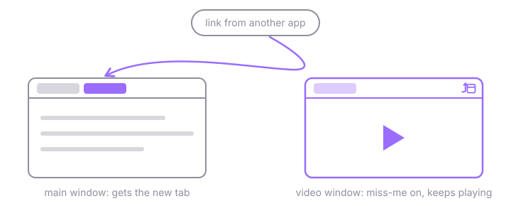

  

<h1 align="center">miss-me</h1>

<em>Miss me with that new tab.</em>

A Zen/Firefox extension that makes a window dodge new tabs. Turn it on in the
window playing your video, and links you click in other apps open somewhere
else.

  

## Usage

Click the toolbar button to toggle it for the current window.

| | |
|---|---|
|  | **Off:** the window takes new tabs as usual. |
|  | **On:** tabs from other apps go to the window you used last, or a new one. |

Tabs you open from inside the window stay put: links from its pages, Ctrl+T,
and pinned tabs. The setting is remembered across restarts.

## Install

1. Build the zip: `dagger call -m ./ci build export --path miss-me.zip`
2. Get it signed at [addons.mozilla.org](https://addons.mozilla.org/developers/),
   then install the `.xpi` from `about:addons` → ⚙ → **Install Add-on From File…**
3. Pin the button: extensions menu (puzzle piece) → right-click **miss-me** →
   **Pin to Toolbar**.

To try it without signing, load `extension/manifest.json` from `about:debugging`
→ **This Firefox** → **Load Temporary Add-on…**. It's removed on restart.

## Limitations

- A fullscreen video may exit fullscreen when a tab is dodged.
- Reopening a closed tab (Ctrl+Shift+T) in the window gets dodged too.

## Development

`dagger check` lints the extension with Mozilla's `web-ext lint`.
